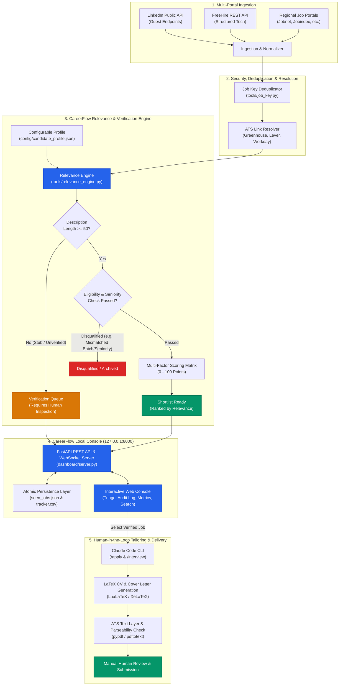

<p align="center">
  
</p>

# CareerFlow — AI Job Search & Application Intelligence

> **A local-first, privacy-respecting intelligence platform and dashboard for automated job discovery, multi-factor relevance scoring, strict vacancy verification, and end-to-end application lifecycle tracking.**

[](tests/)
[](https://www.python.org/)
[](https://fastapi.tiangolo.com/)
[](LICENSE)
[](#quick-start-windows-powershell)

---

## Overview

**CareerFlow** transforms open-source job aggregation into an intelligent, locally hosted career engineering cockpit. Built on top of the open-source [MadsLorentzen/ai-job-search](https://github.com/MadsLorentzen/ai-job-search) agentic framework, CareerFlow adds an independent **FastAPI-powered analytical dashboard**, a **domain-agnostic relevance and verification engine**, **deterministic seniority and graduation eligibility gates**, **vacancy authenticity safeguards**, and **thread-safe atomic state tracking**.

CareerFlow is engineered with a **local-first, security-conscious philosophy**:
- **Zero Autonomous Submissions:** CareerFlow never blindly applies to jobs, messages recruiters, or uploads materials without your review. You maintain 100% control over every submission.
- **Strict Verification Safeguards:** Scraped aggregator stubs and incomplete postings (< 50 characters) are quarantined into a dedicated verification queue to prevent ghost jobs or fabricated listings from reaching your shortlist.
- **Complete Data Privacy:** Your resume, behavioral notes, compensation preferences, and application tracking data remain strictly on your local machine (`127.0.0.1`).

---

## Architectural Distinctions: Upstream Framework vs. CareerFlow Additions

| Feature Domain | Upstream Framework (`ai-job-search`) | CareerFlow Enhancements (`simpsonr06/CareerFlow`) |
| :--- | :--- | :--- |
| **Primary Interface** | Claude Code CLI commands (`/setup`, `/scrape`, `/apply`) | **Local Web Dashboard (FastAPI + Modern Web UI)** + CLI workflows |
| **Relevance & Scoring** | LLM-prompted text evaluation rubric in markdown | **Deterministic Multi-Factor Scoring Engine** (Role, Seniority, Skills, Location, Comp, Freshness) |
| **Posting Verification** | Basic URL validation | **Strict Vacancy Verification Safeguards** (quarantines short stubs, requires proof of active ATS opening) |
| **Seniority & Eligibility**| Free-text LLM judgment | **Configurable Eligibility Gates** (specialized vs. generic role weighting, graduation batch filters e.g. 2027) |
| **Data Persistence** | Direct JSON/CSV file writes | **Thread-safe `RLock` synchronization**, atomic temp writes with `fsync`, and automatic `.bak` backups |
| **ATS Handling** | Basic link retention | **Direct ATS Link Resolver** (canonicalizes Greenhouse, Lever, Workday links; eliminates tracking redirect spam) |
| **Duplicate Prevention** | Basic URL/ID checking | **Cryptographic & Semantic Job Key Deduplication** across disparate job portals and aggregators |

---

## System Architecture



---

## Key Features

### 1. Configurable Candidate Profile (`config/candidate_profile.json`)
Easily align the system to your individual career phase:
- **Specialized vs. Broad Roles:** Calibrates high scores for primary domains (e.g., *Cybersecurity Engineer*, *SOC Analyst*, *Cloud Security*) while preventing generic titles (*Software Engineer Intern*) from claiming maximum alignment.
- **Graduation & Batch Filters:** Explicit eligibility enforcement for target cohorts (e.g., 2027 batch internships vs. graduated full-time roles).
- **Multi-Tier Skill Stacks:** Differentiates essential core proficiencies from complementary bonus skills across security, engineering, and infrastructure domains.
- **Location & Remote Preferences:** Enforces target geographical boundaries and remote work allowances.

### 2. Multi-Dimensional Relevance Scoring Engine (`tools/relevance_engine.py`)
Rather than relying on opaque LLM approximations, CareerFlow evaluates jobs against a deterministic 100-point rubric:
- **Role Alignment (up to 45 pts):** Granular calibration distinguishing specialized matches from broad fallbacks.
- **Seniority Fit (up to 15 pts):** Strict disqualification gates ensuring entry-level candidates are not routed to Senior or Director positions.
- **Skill Synergy (up to 25 pts):** Contextual token matching across technical capabilities, frameworks, and tools.
- **Location Alignment (up to 5 pts):** Evaluates geographic match and remote compatibility.
- **Compensation & Freshness (up to 5 pts):** Rewards transparency in pay bands and prioritizes freshly posted openings.

### 3. Rigorous Vacancy Verification Safeguards
Aggregators frequently scrape dead postings, stale redirects, or incomplete stub summaries. CareerFlow addresses this:
- **Description Integrity Gate:** Job postings with empty or truncated descriptions (< 50 characters) are automatically blocked from `SHORTLIST_READY` and quarantined into the `VERIFICATION_QUEUE`.
- **Proof of Active Posting:** Listings remain unverified until corroborated with full job text or an active direct employer link.
- **Audit Logging:** Every manual verification, status transition, and triage note is recorded with timestamped audit entries.

### 4. Interactive Local Dashboard (`dashboard/`)
- **FastAPI + Modern Web UI:** Lightning-fast, zero-cloud web application running strictly on `http://127.0.0.1:8000`.
- **Triage Pipeline:** Move jobs seamlessly between *Verification Queue*, *Shortlist*, *Applied*, *Interviewing*, *Offered*, and *Archived*.
- **Real-Time KPI Metrics:** Live metrics tracking total jobs discovered, verification backlogs, average relevance scores, and application funnel conversion rates.
- **On-Demand Search Trigger:** Execute rate-limited portal scrapes directly from the UI without touching the command line.

### 5. Local-First Security & Resilience
- **Loopback Enforcement:** Binds exclusively to `127.0.0.1`, guaranteeing that application and candidate data cannot be accessed from public or external network interfaces.
- **Atomic File Operations:** File modifications to `seen_jobs.json` and `job_search_tracker.csv` use atomic write-replace semantics with `os.replace()` and `fsync()`, supplemented by automatic `.bak` recovery snapshots.
- **Concurrency Safety:** All state mutations are guarded by re-entrant mutex locks (`threading.RLock()`).
- **Command Injection Prevention:** Subprocess executions (such as Bun search CLIs) enforce array-based parameterization with `shell=False`.

---

## Technology Stack

| Layer | Technologies | Purpose |
| :--- | :--- | :--- |
| **Backend API** | Python 3.10+, FastAPI, Uvicorn, Pydantic | REST endpoints, WebSocket event streams, request validation |
| **Frontend UI** | HTML5, Modern Vanilla CSS, Vanilla JavaScript (ES6+) | Lightweight, reactive, dependency-free local dashboard |
| **Relevance & Verification** | Python Regex, Standard Library JSON/CSV/Hashlib | Deterministic 100-pt scoring matrix, job key hashing, ATS link resolution |
| **CLI Job Portals** | Bun runtime, TypeScript | Fast, unauthenticated scrapers (LinkedIn Guest API, FreeHire REST API) |
| **Application Pipeline** | Claude Code CLI, Agent Skills | Autonomous drafter-reviewer resume and cover letter drafting |
| **Document Processing** | LuaLaTeX (`moderncv`), XeLaTeX (`cover.cls`), PyPDF | High-fidelity 2-page CV and 1-page cover letter PDF compilation + ATS parsing check |
| **Testing & CI** | Pytest, Unittest, Subtests | Regression testing, contract validation, atomic write integrity |

---

## Quick Start (Windows PowerShell)

### 1. Prerequisites

1. **Python 3.10+**: Ensure Python is available:
   ```powershell
   python --version
   ```
2. **(Optional) Bun**: Needed if running live portal scrapers (`linkedin-search`, `freehire-search`):
   ```powershell
   powershell -ExecutionPolicy Bypass -c "irm https://bun.sh/install.ps1 | iex"
   ```
3. **(Optional) MiKTeX**: Needed if compiling LaTeX CV and cover letter PDFs ([MiKTeX Download](https://miktex.org/download)).

### 2. Clone the Repository

```powershell
git clone https://github.com/simpsonr06/CareerFlow.git
Set-Location CareerFlow
```

### 3. Create a Virtual Environment & Install Dependencies

```powershell
# Create and activate virtual environment
python -m venv .venv
.\.venv\Scripts\Activate.ps1

# Install required dashboard and testing packages
pip install fastapi uvicorn pydantic pytest
```

### 4. (Optional) Install Job Portal CLI Tools

If using portal search skills locally:
```powershell
python tools\install_portal_clis.py
```

---

## Running CareerFlow

### Launch the Web Dashboard

Start the local server using Python module invocation:

```powershell
python -m dashboard.server
```

*(Alternatively, run using Uvicorn directly)*:
```powershell
uvicorn dashboard.server:app --host 127.0.0.1 --port 8000 --reload
```

Open your browser and navigate to:
```
http://127.0.0.1:8000
```

> **Security Note:** The server is restricted to loopback (`127.0.0.1`). It does not open firewall ports or transmit data over the network.

---

## Running the Automated Test Suite

CareerFlow maintains high engineering rigor with extensive regression suites covering scoring calibration, vacancy safeguards, API stability, and atomic concurrency:

```powershell
# Run the full test suite quietly
python -m pytest -q

# Run specific CareerFlow test suites with verbose output
python -m pytest tests/test_relevance_engine.py tests/test_generalized_engine.py tests/test_dashboard_api.py -v
```

### Confirmed Test Execution Status

```text
======================= test session starts =======================
platform win32 -- Python 3.14.0a3, pytest-8.3.5
rootdir: D:\Simpson\Antigravity\AI Job Search\ai-job-search-personal
collected 651 items

638 passed, 13 skipped, 310 subtests passed in 37.71s
================ 638 passed, 13 skipped in 37.71s =================
```

---

## Screenshots & Media

<p align="center">
  <br>
  <i>CareerFlow's background courier and triage agent mascot.</i>
</p>

### Dashboard Interface Capabilities

When launched at `http://127.0.0.1:8000`, the CareerFlow dashboard presents:
- **KPI Overview Cards:** Real-time counts of discovered opportunities, verification queue backlog, ready shortlist, and active interview pipelines.
- **Verification Safeguards Queue:** Highlights truncated or unverified scraper stubs for human validation before they enter the application stream.
- **Shortlist Command Center:** Ranked job cards displaying calculated relevance scores (0–100), key breakdown badges (Role, Skills, Seniority), direct employer links, and one-click status transitions.
- **Interactive Application Tracker:** Tabular view of applications submitted, interview stages, follow-up timers, and archived outcomes linked to `job_search_tracker.csv`.

*(To add customized visual walkthroughs or UI screenshots to your portfolio fork, save your PNG/WebP captures in `assets/screenshots/` and link them here).*

---

## Repository Structure

```text
CareerFlow/
├── config/
│   └── candidate_profile.json         # CareerFlow: Configurable candidate target criteria
├── dashboard/
│   ├── server.py                      # CareerFlow: FastAPI REST server & WebSocket backend
│   ├── static/                        # CareerFlow: Modern, dependency-free dashboard UI
│   │   ├── index.html                 # Main dashboard markup
│   │   ├── style.css                  # Responsive dark/light theme CSS
│   │   └── app.js                     # State management, API bindings & WebSocket handler
│   └── README.md                      # CareerFlow dashboard architecture documentation
├── tools/
│   ├── relevance_engine.py            # CareerFlow: Multi-factor scoring & verification engine
│   ├── ats_resolver.py                # CareerFlow: Resolves direct Greenhouse/Lever/Workday links
│   ├── job_key.py                     # CareerFlow: Canonical deduplication hashing
│   ├── atomic_write.py                # CareerFlow: Concurrency-safe atomic persistence
│   ├── install_portal_clis.py         # Upstream: Automatic Bun CLI package installer
│   ├── verify_pdf.py                  # Upstream: PDF page count & text extraction validator
│   └── verify_layout.py               # Upstream: LaTeX layout & visual inspection tool
├── tests/
│   ├── test_relevance_engine.py       # CareerFlow: Safeguard ordering & role scoring tests
│   ├── test_generalized_engine.py     # CareerFlow: Multi-domain profile regression suite
│   ├── test_dashboard_api.py          # CareerFlow: FastAPI endpoint & verification tests
│   ├── test_ats_resolver.py           # CareerFlow: Direct ATS link extraction tests
│   └── test_job_key.py                # CareerFlow: Deduplication key consistency tests
├── .agents/skills/                    # Upstream & Custom Portal Search Skills
│   ├── linkedin-search/               # Country-agnostic LinkedIn guest search
│   ├── freehire-search/               # Country-agnostic FreeHire tech aggregator
│   └── jobnet-search/                 # Danish national portal integration
├── cv/
│   └── main_example.tex               # ModernCV LaTeX banking style template
├── cover_letters/
│   ├── cover.cls                      # Custom cover letter LaTeX class
│   └── OpenFonts/                     # Lato & Raleway typography assets
├── job_scraper/
│   └── seen_jobs.json                 # Local-first raw and evaluated vacancy repository
├── job_search_tracker.csv             # Local-first application status tracking spreadsheet
├── CLAUDE.md                          # Upstream: Claude Code CLI agent instructions
├── SETUP.md                           # Comprehensive environment setup guide
├── CONTRIBUTING.md                    # Upstream contribution policies
└── LICENSE                            # MIT License
```

---

## Privacy, Security, Limitations & Human Verification

### Ethical Human-in-the-Loop Philosophy
CareerFlow is strictly an **intelligence and productivity assistant**, not an automated application spammer. The platform deliberately avoids autonomous application submissions. Applying to an employer should always involve deliberate human review of the company, role fit, and tailored documents.

### Vacancy Authenticity Limitations
Job postings aggregated from public endpoints or search indexes may occasionally include outdated postings, closed requisitions, or aggregator spam. **CareerFlow's verification safeguards are designed specifically to catch these issues** by flagging truncated summaries (< 50 characters) and requiring user confirmation before jobs advance to the shortlist.

### Local-First Data Security
- No telemetry, analytics, or background cloud syncs are bundled.
- All personal profile information, notes, and documents remain on your storage volume.
- The web console binds exclusively to `127.0.0.1` and should never be exposed to the public internet without an authentication proxy.

---

## Upstream Attribution & License

This project is built upon and significantly extends the open-source **[ai-job-search](https://github.com/MadsLorentzen/ai-job-search)** framework authored by **[Mads Lorentzen](https://github.com/MadsLorentzen)**.

- **Original Framework:** Developed by Mads Lorentzen (MIT License, Copyright © 2026). Upstream contributions include the Claude Code agentic workflows, LaTeX document compilation pipelines, ATS parseability checks, and initial portal search concepts.
- **CareerFlow Customizations:** Developed by **[simpsonr06](https://github.com/simpsonr06)**. Additions include the local-first FastAPI management dashboard, domain-agnostic relevance and verification engine, graduation/batch eligibility filters, vacancy verification safeguards, atomic persistence layer, and extensive automated test suites.
- **License:** Both the upstream framework and CareerFlow are licensed under the terms of the [MIT License](LICENSE).

---

## Roadmap

- [x] Multi-factor deterministic relevance engine with generic vs. specialized role calibration.
- [x] Verification safeguard quarantine for truncated (< 50 chars) and unverified listings.
- [x] Concurrency-safe atomic persistence with automatic backup rotation.
- [x] Local FastAPI dashboard with WebSocket live status sync.
- [ ] **ATS Direct Auto-fill Helper:** Browser-side userscript/extension to assist in populating Greenhouse/Lever fields manually without copy-paste fatigue.
- [ ] **Interview Question Bank Integration:** Dynamic generation of technical interview questions mapped to specific job requirements and candidate STAR stories.
- [ ] **Exportable Analytics Reports:** Export formatted PDF/CSV audit reports of job search funnels, rejection feedback, and interview conversion ratios.
- [ ] **Multi-Profile Switching:** UI-driven profile switcher allowing candidates to toggle between distinct personas (e.g. Security Analyst vs. DevOps Engineer) on the fly.
